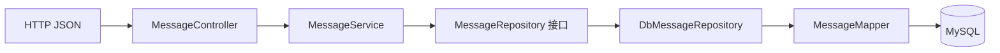

# 前八次实战的验收与历史实验复现

依据根目录《MyBlog_前八次实战核心任务确认表》及第 5～8 周教程。这里列出操作和预期结果，不代表已经运行、截图或达标。最终版不再同时暴露被后续课程替代的旧行为。

## 验收前准备

1. 按 README 在独立人工验收库建表并配置环境变量，手动启动应用。
2. 在任何播种操作前确认连接的是自己的验收库。`CREATE TABLE IF NOT EXISTS` 不会修正旧表结构；先核对 `SHOW CREATE TABLE`，已有数据不要清空或自动重建。
3. 需要精确验证 total=10、hello=3 时，使用一个新的空白验收库，并且只执行一次 `sql/seed-messages.sql`。如果库里已经有数据，保留它们，改用实际总数作为预期，不为凑数删除记录。
4. IDE HTTP Client 可执行 `.http` 文件中的响应处理脚本；Apifox/Postman 使用同样的路径和 JSON，手动复制真实 ID。文件里的“预期”不是执行结果。
5. 截图、SQL 结果、请求响应、真实 AI 交流和 Git 记录由操作人保存在自己指定的课程证据位置。不要把真实密码、连接信息或私人日志放进提交内容。

## Week01～03：存在、表达和身份

- 观察启动日志中的 Tomcat 端口和 `Started MyBlogApplication`；根路径没有页面，返回 404。
- `/hello` 仍是文本，当前未包含真实姓名，需在 `HelloController` 中自行个性化；`/me` 和 `/profile` 以原有字段形式返回 JSON，不套 Result。
- 在 `ProfileController.createProfile()` 中填写真实的博客名、姓名、简介、兴趣和愿景；`/me` 自动复用同一份资料。
- 用 DevTools 保存状态码、响应正文和 `application/json` 响应头，并自行解释浏览器 → HTTP → Tomcat → Spring 路由 → 方法返回 → 响应的过程。
- 当前 `/profile` 是 Week03 的五字段资料，Week02 的三字段 `BlogProfile(name,owner,message)` 已被升级。可在独立学习副本中按 `02/lab02.docx` 创建该 DTO 和旧端点，不在正式项目注册另一份 `/profile`。
- 找同学实际进行 Recognition Test，记录对方如何认出你。占位值不能证明身份。
- 人工检查 Git diff，完成有意义的 Week03 提交并推送到自己的仓库。最终版补交的提交不能冒充历史记录；没有记录时按实际时间说明补做。

## Week02 的三个破坏实验

只在自己指定的独立学习副本中实验。一次只改一个点，观察并记录后立刻恢复；不要把损坏版本带回最终项目。

1. **返回 String 与对象**：同一个测试路由分别返回一句文本和 `BlogProfile`；对比响应正文和 Content-Type。两者都可以是 200，200 不能证明 JSON 结构成立。
2. **Controller 与 RestController**：把学习副本中的 `@RestController` 改为 `@Controller`，在无 `@ResponseBody` 时观察视图处理而非直接写响应体的行为；结果受视图配置影响，不能预填固定状态。恢复后再验。
3. **字段改名**：将 DTO 的 `owner` 改为 `author` 并同步赋值，观察 JSON key 随之改变，然后恢复。

每项记录实际问题、先验猜想、真实 AI 提问、观察和恢复结果。课程要求的 `ai-log.md` 应由本人根据真实交流填写；本项目不伪造对话。

## Week04～05：倾听、结构和依赖注入

最终链路是：



- 发送两条不同留言，再按真实数据库 ID 查询，验证响应确实带回原内容。当前 POST 返回 201；列表已经升级为分页对象，不能按 Week04 的裸数组验收。
- `InMemoryMessageRepository` 没有组件注解，仅供教学/独立测试。`MessageServiceTest.reconstructingMemoryRepositoryLosesData` 展示重建内存仓库后丢失数据；真正的 Week04 重启截图需要在独立学习副本复现，不是最终数据库版的行为。
- 复现缺/错 Content-Type：发送无 JSON Content-Type 的 POST，观察 415；JSON 字段写成 `text` 时，最终版因校验返回 400，早期“200 但 content=null”的行为需按 Week04 文档在学习副本暂时关闭校验后复现，恢复校验后确认 400。
- **材料勘误**：最终项目同时支持 `GET /messages` 和 `POST /messages`，因此把 POST 改成 GET 不会产生 405，而会查询列表。使用 `PUT /messages` 可验证 405，使用不存在的路径可验证 404；不要伪造“GET /messages 得到 405”的结果。
- Week05 分层对照必须在相同响应契约下只做重构。当前版本同时包含 ID、持久化和分页升级，不能拿 Week04 的裸数组与最终分页对象宣称“完全一致”。若没有早期基线，在学习副本按第 5 周代码重做并如实标注补做。
- DI 实验：在学习副本中仅注释 `MessageService` 的 `@Service`，手动启动观察缺少 Bean 的报错，恢复注解后重新启动；最终项目不执行这个破坏操作。解释构造器参数在容器启动时被接线。

## Week06：MySQL 是唯一数据源

1. POST 一条包含唯一标记的留言，保存真实 id/content/createdAt。
2. 在 MySQL 中手动执行 `INSERT INTO message(content) VALUES ('direct-db-insert-你的唯一标记');`，再以该标记作为 keyword 请求列表，证明 GET 读的是真实数据库。
3. 彻底停止应用并手动重新启动，按原 ID 回读；id、content、createdAt 应与重启前一致。内存仓库测试不能替代持久化证据。
4. 检查只有 `DbMessageRepository` 注册为 Repository，生产创建/读取路径没有调用教学内存实现。
5. 运行 `sql/verify.sql` 中的只读查询，截图保存表结构和查询结果。

## Week07：八项搜索分页矩阵

在一次性播种的十条数据基础上，依次手动执行 `requests-week07.http`：

| 项目 | 请求 | 预期 |
| --- | --- | --- |
| 1 | `keyword=hello` | total=3，每条命中 |
| 2 | `keyword=dragon` | items=[]、total=0 |
| 3 | `page=1&size=5` | 5 条、total=10 |
| 4 | `page=2&size=5` | 另外 5 条、total=10 |
| 5 | `page=99&size=5` | items=[]、total=10 |
| 6 | `keyword=hello&page=1&size=2` | 2 条、total=3 |
| 7 | `keyword=hello&page=2&size=2` | 1 条、total=3 |
| 8 | POST 后 GET 真 ID | 201 创建，200 回读，内容一致 |

第 8 项会增加记录，先完成前 7 项。使用合法、有匹配数据的分页请求查看 DEBUG 日志，确认 COUNT 和 LIMIT。无匹配时分页插件可能只发 COUNT 并跳过第二条查询，这是正常优化，不能因此判定分页失效。

如需复现“缺拦截器静默全量”，在学习副本暂时移除分页 Bean，记录实际 SQL 和返回差异，再恢复。最终项目默认保留拦截器。

## Week08：文章全生命周期与连续性

按 `requests-week08.http` 顺序执行：保存留言分页与身份的开工前响应 → 发布文章 → 单篇回读 → 搜索 → PUT 修订 → 回读 → 硬删除刚创建的单篇 → 同 ID 404 → 对比原留言与身份。

文章成功体是 `{code:0,message:"ok",data:...}`，失败体仍有三格，同时 HTTP 状态也是真正的 400/404。不是 HTTP 200 中藏一个 code=404。PUT 仅修改提供的 title/content；省略字段保留，显式 null、空白和空对象被拒绝。重复提交相同有效内容可以成功。

请求文件中的两张“照片”能证明本次文章操作没有改变其他资源。若要证明“加文章代码前后未变”，必须在文章功能加入前的真实 Week07 运行版采集第一张，加入后采集第二张；本次未运行应用，因此没有该历史基线，不以当前响应冒充。

## 手动测试入口

以下命令都由本人决定何时执行，本次没有运行：

```powershell
Set-Location -LiteralPath 'C:\develop\WEB_Programming\.MyBlog'
# 编译并运行独立测试和 MVC 契约测试，不连接 MySQL。
mvn test
# 在专用测试库建好表、设置 MYBLOG_TEST_DB_* 后，才执行真实数据库测试。
mvn -Pmysql-it verify
```

集成测试使用 `MYBLOG_TEST_DB_URL`、`MYBLOG_TEST_DB_USERNAME`、`MYBLOG_TEST_DB_PASSWORD`，缺失时失败，不回退开发库。请在一个新建的专用测试库中只执行 `schema.sql` 的两段 CREATE TABLE（不要执行其中指向开发库的 CREATE DATABASE / USE）。测试通过事务回滚数据；MySQL 自增序列的消耗不会回滚。测试覆盖数据库直插、真实分页、文章生命周期和留言连续性，不能替代跨进程重启实验。

所有自动检查的源码均已准备，但未经编译或执行；在实际通过之前，不在确认表勾选达标。
